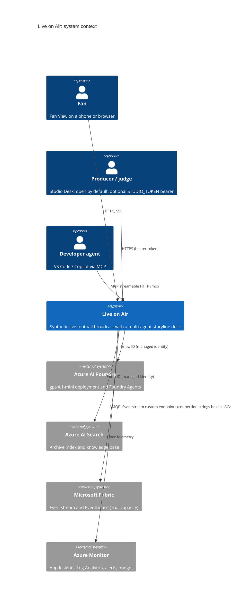
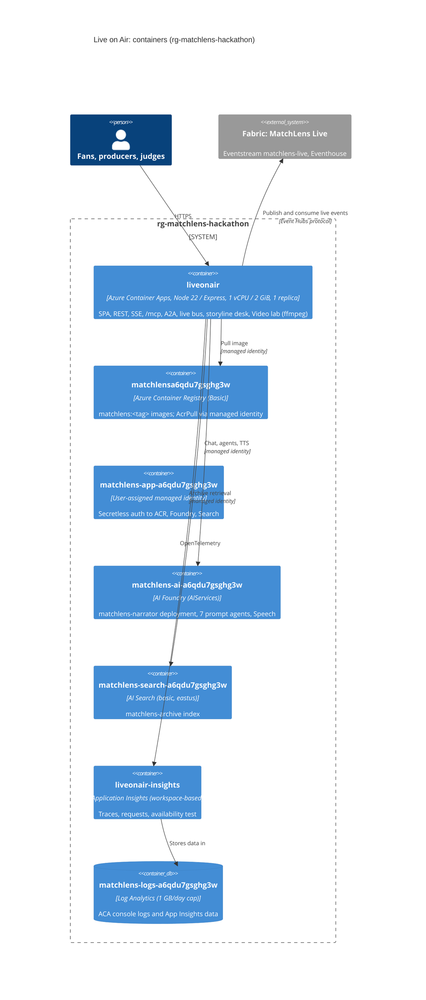
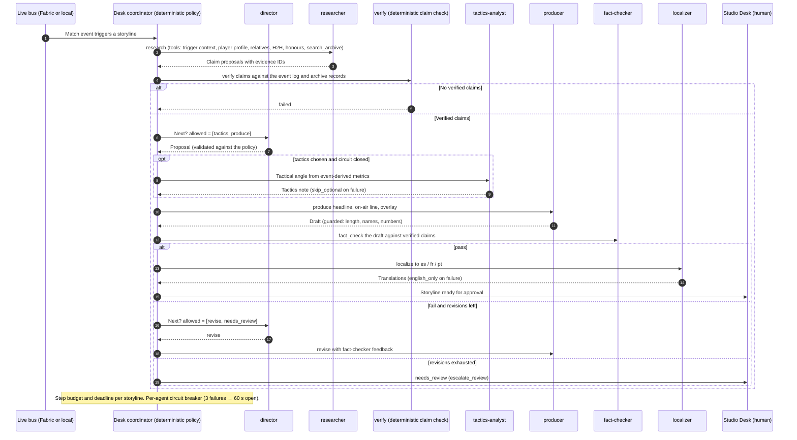

# Live on Air architecture

Scope: the judged deployment in `rg-matchlens-hackathon` (subscription `5d2da101-…`, East US 2),
judging window 2026-10-27 to 2026-11-10. All match data is synthetic.

- [runbook.md](runbook.md): deploy, rollback, smoke test and alert handling during judging.
- [../../fabric/README.md](../../fabric/README.md): Fabric real-time layer and decision D4 (trial end date).

## C4 level 1: system context

## C4 level 2: containers

Design constraints:
- **Single replica.** minReplicas = maxReplicas = 1, because live match state, SSE fan-out and desk
  state are in-process. Scaling out would split state. Availability depends on fast restarts and
  the watchdog, not on redundancy.
- **Single revision mode.** Traffic always goes to the latest revision. Rollback means deploying the
  previous image (see the runbook); activating an old revision is not enough.
- **Secretless where Azure allows it.** Foundry, Search and ACR use the managed identity. The only
  secrets are the Eventstream connection strings, the App Insights connection string and
  the optional `STUDIO_TOKEN` (unset by default, so Studio is open), all held as Container Apps secrets and supplied only at deploy time.

## Storyline desk: agent handoffs

Source: `server/desk/coordinator.ts` (transition policy), `server/desk/index.ts` (desk loop and
recovery) and `server/desk/agents/*` (Foundry prompt agents). The deterministic policy defines the
legal moves. The **director** agent picks among them only where there is a real choice. An illegal or
failed director proposal falls back to the policy default and is recorded in the trace.

Legal path: `research → verify → [tactics] → produce → fact_check → (revise → fact_check | localize | needs_review) → done`.

The **player-analyst** is a separate Foundry agent. It isn't part of the storyline desk: it writes
on-demand player scouting notes for the Studio and Fan View.

## Recovery matrix

Rows marked † depend on backend work in wave 1 (fabric-fallback, studio-auth, watchdog, rate-limit
message). Re-verify them against `server/` before judging.

| Failure | Detection | Automatic behaviour | Operator action |
|---|---|---|---|
| Fabric Eventstream down, or trial expired † | Publish error in transport | Runtime switch to the in-process local bus; `/api/live/status` → `transport: local`; UI badge | None needed for the demo. Record in D4; optionally move the workspace to an F2 capacity |
| Fabric secrets missing at deploy | `deploy.ps1` preflight | Deploy refuses to run | Restore `fabric/.secrets.local.json`, or pass `-AllowLocalTransport` deliberately |
| Foundry 429 / quota † | `classifyError` → `rate_limit` | One retry, then circuit breaker; app-level cap `AI_MAX_REQUESTS_PER_HOUR` (120) returns a clear rate-limit message | Check the Foundry quota; raise capacity on `matchlens-narrator` via IaC |
| Agent timeout / invalid schema | `withTimeout`, Zod | `retry_with_feedback` once, then policy fallback | None |
| Director unavailable | Director error | Deterministic policy default (`decidedBy: policy`) | None |
| Tactics analyst failing | Circuit open | `skip_optional`: storyline continues without tactics | None |
| Localizer failing | Error or guard reject | `english_only`: story ships in English, flagged for review | None |
| Fact-check keeps failing | Revisions exhausted | `escalate_review` → `needs_review` in the Studio | Producer approves or discards |
| AI Search unavailable | Retrieval error | The `search_archive` tool fails for the researcher; claims must rest on other tool data (event log, dossier). *Behaviour not verified end to end.* | Check the search service |
| Container crash / OOM † | ACA restart; `liveonair-restarts`, `liveonair-memory` alerts | ACA restarts the replica (probes on `/api/health`); the demo watchdog (`DEMO_WATCHDOG_MINUTES`=10) restarts an idle demo match | Check the logs; roll back if a new revision is at fault |
| App down / unhealthy | `liveonair-availability` (2 of 3 locations), `liveonair-no-replicas` | Liveness probe restart | Runbook: check the revision, then roll back |
| Bad deploy | Smoke test fails | None (Single revision mode) | Runbook: redeploy the previous image tag with `-SkipBuild` |
| Telemetry dropped | Log Analytics `OverQuota` | None | Daily cap raised to 1 GB; check what is driving the volume |
| Cost runaway | Budget 80% actual / 100% forecast | Notification only | Check the Foundry and Search spend |
| Producer endpoints abused † | Unexpected starts/stops/corrections (Studio is open by default since 2026-10-22, by product decision) | Rate limiters; optional `STUDIO_TOKEN` bearer on producer endpoints | Turn auth on: add the `studio-token` secret and `STUDIO_TOKEN` env (runbook section 4) |
